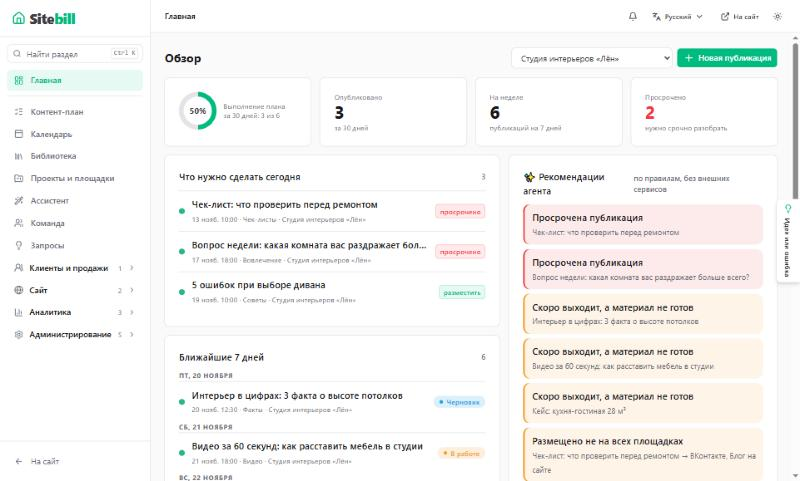
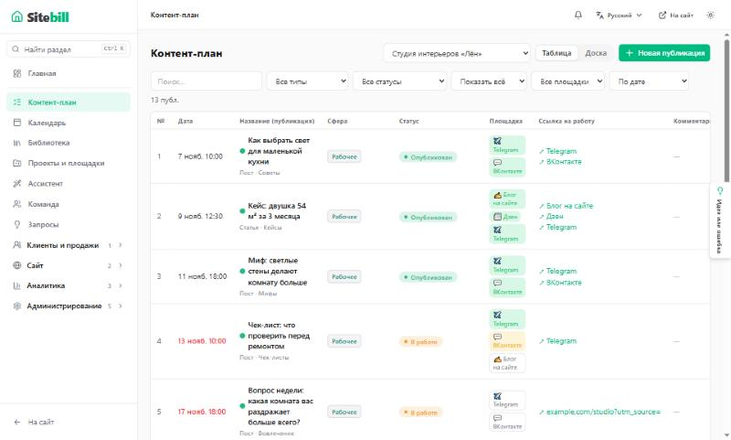
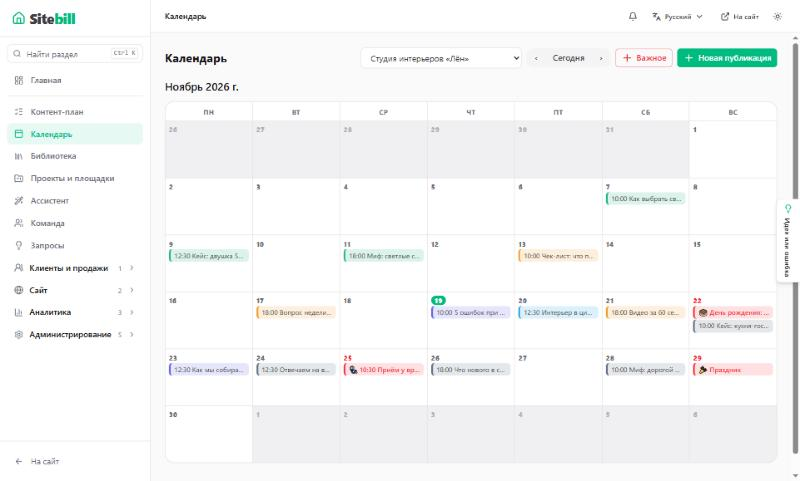
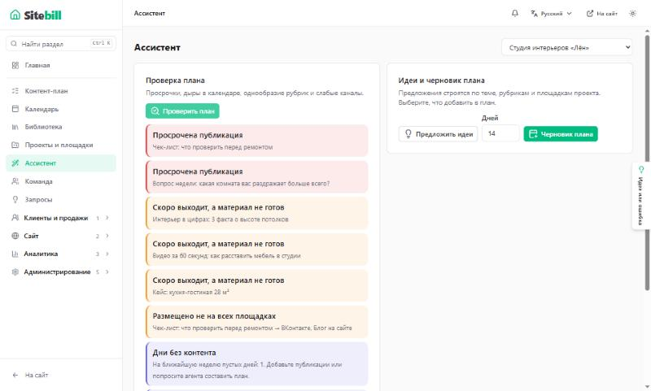

# Content Factory — content plan, editorial calendar and team workflow for Sitebill

**EN** · An open-source **content marketing workspace** for the [Sitebill](https://sitebillcms.com/?utm_source=github&utm_medium=readme&utm_campaign=content-factory) platform: several projects and brands, publishing channels (Telegram, VK, Dzen, vc.ru, Habr, blog, newsletter…), a **content plan** (table + kanban), a **month calendar**, a material library, the **status of every publication on every channel**, a **team with roles** (owner / editor / author / approver / viewer) and a built-in **assistant** that finds gaps in the plan, suggests ideas and drafts a plan for a period. **AI helper** inside the publication card: write a draft, rewrite, adapt to a channel, suggest titles and hashtags — with your own provider key or the platform model; AI never saves anything by itself. **AI ideas and period plan**, **batch adaptation to all channels** (queued, every result is a draft version), and an **approval feed with comments** (approve / send back) are the «factory» part — see the [roadmap](docs/ROADMAP.md).

**RU** · Открытая **контент-фабрика** для платформы [Sitebill](https://www.sitebill.ru/?utm_source=github&utm_medium=readme&utm_campaign=content-factory): несколько проектов и брендов, площадки (Telegram, ВКонтакте, Дзен, vc.ru, Habr, блог, рассылка…), **контент-план** (таблица и канбан), **календарь на месяц**, библиотека материалов, **статус каждой публикации на каждой площадке**, **команда с ролями** (владелец / редактор / автор / согласующий / наблюдатель) и встроенный **ассистент**: находит дыры в плане, предлагает идеи, составляет план на период. **ИИ-помощник** в карточке публикации: черновик, переписывание, адаптация под площадку, заголовки и хештеги — на вашем ключе провайдера или модели платформы; сам ничего не сохраняет. **ИИ-идеи и план на период**, **пакетная адаптация под все площадки** (в очереди, каждый результат — черновик-версия) и **лента согласования с комментариями** (согласовать / на доработку) — это «фабрика», см. [дорожную карту](docs/ROADMAP.md).

[](LICENSE)
[](https://sitebillcms.com/?utm_source=github&utm_medium=readme&utm_campaign=content-factory)




## Who is it for / Для кого

- **SMM and content managers, editorial teams, agencies** who run several brands and need one plan instead of a spreadsheet, a chat and a messenger of reminders.
- **Founders and experts** who publish to many channels and lose track of what is already posted where.
- **SMM-специалисты, редакции, агентства**: один контент-план на несколько проектов вместо таблицы, чата и напоминаний в мессенджере.
- **Эксперты и владельцы бизнеса**, которые публикуют на многих площадках и теряют, что уже где опубликовано.

An alternative to a hand-made Google Sheets / Notion / Trello content calendar that understands *channels*, *placement status* and *approval*. / Альтернатива самодельному контент-плану в Google Таблицах, Notion или Trello — с понятием площадки, статуса размещения и согласования.

## Features / Возможности

| | |
|---|---|
| 📅 **Content plan & editorial calendar** | table with filters (sphere, status, placed / not placed, channel, sort), **kanban board** with drag & drop, **month calendar** with drag to another day, «important dates» (birthdays, holidays…) |
| 📣 **Multi-channel publishing status** | one publication → many channels; each placement has its own status, link and date; the **overall status is calculated** (all done → *Published*, some → *Partly published*) |
| 👥 **Team workflow** | roles *owner · editor · author · approver · viewer*; an author cannot mark a post *Ready* or *Published* — it goes to **review**, the approver or editor moves it on; rights are enforced on the backend |
| ✨ **AI helper** | draft, rewrite (improve / shorten / expand / simpler / more formal), adaptation to a channel within its length limit, titles, hashtags; the project card (topic, audience, tone, keywords) is the «brand memory» of every prompt; your key (OpenAI-compatible or Claude) or the platform model; every call is logged, limits apply |
| 🧠 **Assistant (rules, no external AI)** | plan review (overdue, not prepared in time, stuck in review, not placed everywhere, stale rubrics, empty days, monotony, low completion, weak channels), ideas, a plan for N days, adaptation to a channel |
| 🗂 **Projects & channels** | topic, audience, tone of voice, keywords, competitors per project; length limit and posts-per-week target per channel |
| 📚 **Library** | books, diary, notes, audience, ideas, hashtags by topic, cases — «make a publication» in one click |
| 🔌 **MCP for AI agents** | 15 tools on the platform's `/mcp` endpoint: overview with brand memory, plan and library reading, writing and moving publications, audiences with pains, comments and approval; visibility follows the team role, see [docs/MCP.md](docs/MCP.md) |
| 🌍 **4 languages** | ru · en · sr · tg (the last two are machine translations — native review welcome) |
| 🏢 **Multi-tenant** | every row carries `tenant_id`, models are scoped automatically; each site on the platform has its own isolated workspace |

| Content plan | Calendar | Assistant |
|---|---|---|
|  |  |  |

## Status / Статус

Phase 1 of the [roadmap](docs/ROADMAP.md): the backend, the web UI, roles and the assistant work in the Sitebill cloud platform as a **site configuration** (`app_type = content`). The AI helper works through the platform AI gateway. Per-tariff limits and the self-hosted (Community) build of this configuration are **planned, not released**.

Фаза 1 из [дорожной карты](docs/ROADMAP.md): бэкенд, веб-интерфейс, роли и ассистент работают в облачной платформе Sitebill как **конфигурация сайта** (`app_type = content`). ИИ-помощник работает через общий ИИ-шлюз платформы. Лимиты по тарифам и self-hosted-сборка (Community) этой конфигурации **запланированы, но не выпущены**.

### Try it today / Попробовать сейчас

- **Self-hosted, right now:** the standalone app [`rumantic.content-manager`](https://github.com/Sitebill/sitebill-app-content-manager) (the single-admin predecessor of this configuration) installs into a free Docker instance of [Sitebill Community](https://sitebillcms.com/?utm_source=github&utm_medium=readme&utm_campaign=content-factory) in a minute.
- **Cloud / Облако:** [sitebill.ru](https://www.sitebill.ru/?utm_source=github&utm_medium=readme&utm_campaign=content-factory) — the hosted platform this configuration is built for.

## How it is built / Как устроено

A Sitebill *configuration* is a module that turns a site into a product. This one is the **form-B module** (`configs/<slug>/{api,web}`): the platform core stays unaware of it and extends only through registries.

```
api/                                       Laravel module  (namespace App\Configs\Content\)
  database/migrations/                     content_* tables, every one with tenant_id
  graphql/content.graphql                  Lighthouse schema, every field under @guard @can
  src/ContentConfigServiceProvider.php     migrations, Gate abilities, team-role resolver
  src/Models/                              BelongsToTenant models: Project, Platform, Publication, Placement, Material, Event, Member
  src/Support/ContentAccess.php            roles → abilities (content.read|write|move|approve|manage|team)
  src/Services/{PlanAgent,PublicationState,DemoData,DefaultPlatforms}.php
  src/GraphQL/Resolvers/                   ContentResolver, TeamResolver
  tests/Feature/ContentAccessTest.php      roles, tenant isolation, team API
web/                                       Nuxt layer  (extended by apps/web)
  app/config.module.ts                     menu, dashboard, member menu for non-admin teammates
  app/pages/admin/content/                 plan · calendar · library · projects · assistant · team
  app/components/configs/content/          dashboard, publication card, modals, status chips
  app/composables/useContentWorkspace.ts   shared state, role hints, mutation helper
  locales/{ru,en,sr,tg}.json               UI strings
docs/                                      architecture, roadmap, screenshots
```

Details: [docs/ARCHITECTURE.md](docs/ARCHITECTURE.md). Rights are always checked on the backend; the roles shown in the UI are hints only.

> This directory is a Sitebill configuration, not a standalone application: it is mounted into the platform (`apps/api` autoloads `App\Configs\Content\`, `apps/web` extends the Nuxt layer). The tests run inside the platform's test suite.

## Roadmap / Что дальше

1. ~~AI core~~ ✅ draft, rewrite, adapt, titles, hashtags through the platform AI gateway (own key or platform model). Still to do: «golden samples» in the brand memory, per-tariff limits.
2. ~~Factory~~ ✅ AI ideas, AI period plan, batch adaptation by queue, approval with comments. A separate «AI factory» dashboard (queue and history) is still to do.
3. **Community build** ✅ — the configuration ships inside the free self-hosted image as a site profile: `community:install --profile=content` (or `COMMUNITY_PROFILE=content`). Tariff keys `content_projects_max` / `content_members_max` apply on the platform.
4. **Publishing** — Telegram / Max / VK through the platform messenger core, image generation, reach metrics.

## Related / Ссылки

| | |
|---|---|
| 🌍 Sitebill (international) | https://sitebillcms.com/ |
| 🇷🇺 Sitebill (Россия и СНГ) | https://www.sitebill.ru/ |
| 📦 Standalone app (predecessor) | https://github.com/Sitebill/sitebill-app-content-manager |
| 🧰 App SDK | https://github.com/Sitebill/sitebill-app-sdk |
| 🎨 Theme SDK | https://github.com/Sitebill/sitebill-theme-sdk |

## Contributing / Участие

Issues and pull requests are welcome — especially native-speaker review of the **Serbian and Tajik** locales, new channel presets and assistant rules. See [CONTRIBUTING.md](CONTRIBUTING.md).

## License

[MIT](LICENSE) © Sitebill

<sub>Keywords: content plan, content factory, editorial calendar, content calendar, SMM planner, social media planner, content marketing, multi-channel publishing, team approval workflow, AI content generator, open source, Laravel, Nuxt, GraphQL, multi-tenant, контент-план, контент-фабрика, редакционный календарь, планировщик публикаций, SMM, согласование публикаций.</sub>
